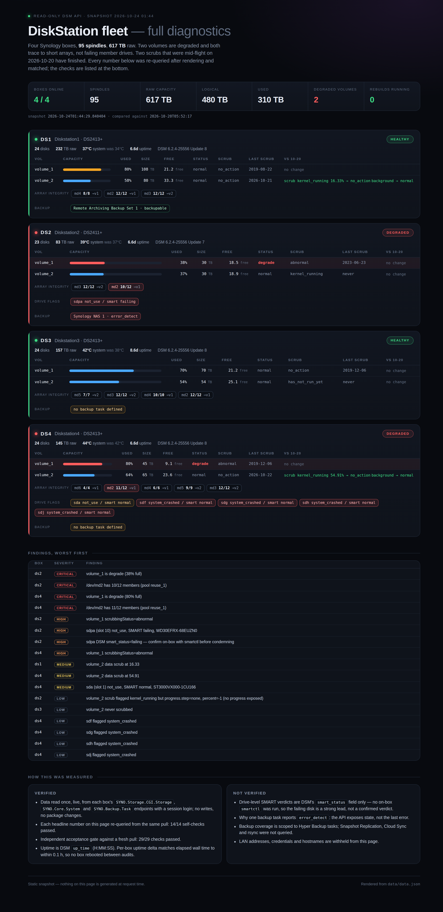

# DiskStation fleet — full diagnostics

A read-only snapshot of four Synology DiskStations (DS2413+ ×3, DS2411+), rendered as a single
static page. No JavaScript, no external fonts, no CDN — the page ships the data it displays.

**Live page:** https://robbonner2-cell.github.io/diskstation-diagnostics/



## Snapshot

Data read **2026-10-24 01:44:29** from the DSM API (`SYNO.Storage.CGI.Storage`,
`SYNO.Core.System`, `SYNO.Backup.Task`) and compared against an earlier audit from **2026-10-20**.
Nothing on the page is generated at request time, so it will not drift from its own stamp.

| box | model | disks | raw | volumes | sys temp |
|---|---|---|---|---|---|
| **DS1** | DS2413+ | 24 | 232 TB | volume_1 80% normal, volume_2 58% normal | 37 °C |
| **DS2** | DS2411+ | 23 | 83 TB | volume_1 38% degrade, volume_2 37% normal | 39 °C |
| **DS3** | DS2413+ | 24 | 157 TB | volume_1 70% normal, volume_2 54% normal | 42 °C |
| **DS4** | DS2413+ | 24 | 145 TB | volume_1 80% degrade, volume_2 64% normal | 44 °C |

Fleet totals: **95 spindles · 617 TB raw · 480 TB logical ·
310 TB used · 2 degraded volumes · 0 rebuilds running**.

## What it says

- **Two volumes degraded**, both traceable to a short array rather than a failing member drive:
  `md2` at 10/12 members on box 2 and 11/12 on box 4, with two-disk and one-disk redundancy left
  respectively. No rebuild is running on any box, so nothing is self-healing.
- **One spare is gone**: a drive flagged `SMART failing` sits outside any array on box 2 — the
  obvious replacement candidate is itself the suspect. Box 4 has an unused drive with normal SMART
  that could take the empty slot instead.
- **Four drives on box 4 carry `system_crashed` flags** while their arrays still report every member
  healthy — the two views disagree, and the page shows both rather than picking one.
- **Scrub scheduling has lapsed everywhere**: every volume's next scheduled scrub date is in the past
  (2019–2025). Two scrubs that were mid-flight on 2026-10-20 have since finished; a third volume has
  never been scrubbed.
- **Backup coverage**: one remote-archive task in a healthy state, one reporting `error_detect`, and
  two boxes with no Hyper Backup task at all.

## Verification

- Every headline number on the page is re-queried from the same pull that produced it: **14/14**
  generator self-checks.
- An independent acceptance gate re-reads all four boxes live and asserts the page's numbers:
  **29/29** checks pass.
- Per-box uptime deltas match elapsed wall time to within 0.1 h, which is what rules out a reboot
  between the two audits. DSM `up_time` is `H:MM:SS`, not days.

### Not claimed

- Drive-level SMART verdicts come from DSM's `smart_status` field alone; no on-box `smartctl` was run.
  Treat the failing drive as a strong lead, not a confirmed failure.
- The cause of the `error_detect` backup state is not exposed by the API and was not investigated.
- Backup coverage is scoped to Hyper Backup tasks only — Snapshot Replication, Cloud Sync and rsync
  were not queried, so "no backup task" is not the same as "unprotected".

## Privacy

LAN addresses, credentials and hostnames are stripped at build time; the generator refuses to emit a
page containing a `192.168.` address. Boxes appear only by their label (`DS1`–`DS4`) and model.

## Rebuilding

```bash
python3 build_site.py path/to/model.json
```

`model.json` is the collector's output (per-box volumes, arrays, drive flags, backup tasks and
findings). The generator rewrites `index.html` and `data/data.json`, then asserts the page stamp
matches the data file and that no LAN address or external URL leaked in.

## License

MIT — see [LICENSE](./LICENSE).
